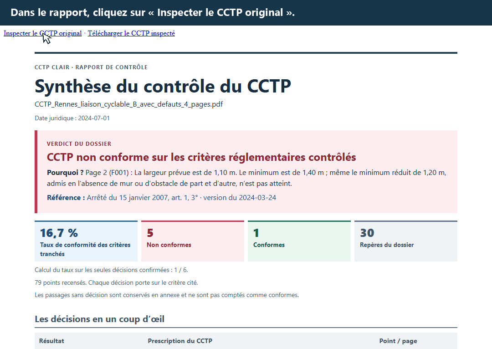
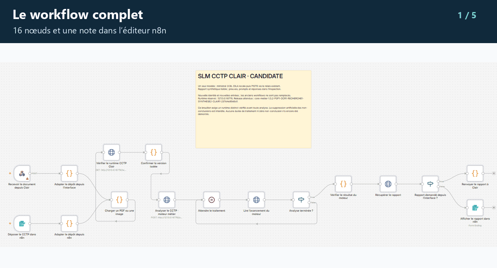
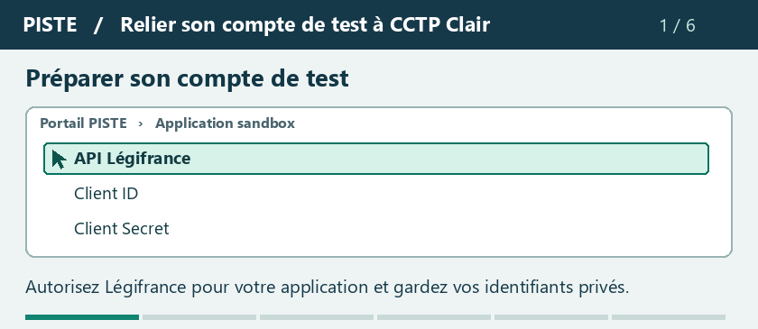

# CCTP Clair

CCTP Clair analyse un cahier des clauses techniques particulières (CCTP) sur votre PC. Pour chaque critère contrôlé, le rapport montre le passage du contrat, l’article utilisé et la raison du verdict.

## Tester le SLM maintenant

**[Télécharger pour Windows](https://github.com/HafidIdrissi/cctp-clair/releases/latest/download/CCTP-Clair-Windows.zip)** · [Ouvrir CCTP Clair s’il est déjà lancé](http://127.0.0.1:8789/)

**Pour vos propres contrats, configurez votre accès PISTE** si vous voulez que CCTP Clair puisse chercher un article sur Légifrance quand les textes DILA de votre PC ne suffisent pas. Le premier exemple ci-dessous fonctionne avec les trois articles inclus. [Créer mon compte PISTE](https://piste.gouv.fr/registration) · [Configurer PISTE sur mon PC](#configurer-piste-sur-mon-pc)

1. Faites un clic droit sur le ZIP → **Extraire tout**. Dans le dossier extrait, double-cliquez sur **Lancer CCTP Clair.cmd**.
2. Gardez la fenêtre ouverte. Quand le navigateur s’ouvre, cliquez sur **Tester avec l’exemple**.
3. Dans **Mes rapports**, attendez **Rapport prêt**, puis cliquez sur **Lire le rapport**.

Pour vérifier le premier essai, cherchez deux passages du PDF fictif dans le rapport. La **largeur libre de 1,10 m** doit apparaître en **rouge (non conforme)** et la **fente de grille de 1,5 cm** en **vert (conforme)**. Survolez un passage ou sélectionnez-le au clavier pour lire la raison et ouvrir l’article sur Légifrance. L’exemple utilise les textes DILA inclus, à la date du 1er juillet 2024.

Le rapport de cet exemple affiche **50 %** : un critère conforme sur deux critères avec une décision confirmée. Seuls les critères déclarés conformes ou non conformes entrent dans le calcul.

Le premier lancement nécessite Windows 10 ou 11 (64 bits), Internet et plusieurs Go libres. Pour tester votre propre contrat, choisissez un fichier, indiquez le lieu et la date, puis cliquez sur **Lancer l’analyse**. Formats acceptés : PDF (15 pages maximum), PNG ou JPEG, jusqu’à 25 Mo.

**Guides animés** · [Voir les annotations](#voir-les-annotations-sur-le-cctp) · [Changer de modèle Ollama](#changer-de-modèle-ollama) · [Utiliser n8n](#tester-depuis-n8n)

## Voir les annotations sur le CCTP

Dans le rapport ou dans **Mes rapports**, cliquez sur **Inspecter le CCTP original**. Survolez un passage encadré, ou sélectionnez-le au clavier. L’annotation affiche le verdict, son motif et le lien **Lire sur Légifrance**.

Sur ce plan de Rennes (page 2), la **largeur libre de 1,10 m** est encadrée en **rouge**. La capture montre le motif, les seuils comparés et l’article utilisé. La **pente de 1,00 %**, encadrée en **vert**, respecte le critère contrôlé.

**Télécharger le CCTP inspecté** enregistre les pages et leurs annotations dans un fichier HTML à rouvrir hors ligne. Les passages dont la position reste incertaine sont listés à la fin.

## Refaire les essais avec les contrats fictifs

- **Rennes, 4 pages.** Analysez les deux versions au **1er juillet 2024**, avec le même modèle. Page 2, la largeur piétonne passe de **1,10 m** à **1,60 m**. Comparez les justifications dans les rapports. [Version B avec défauts](demo/contrats/CCTP_Rennes_liaison_cyclable_B_avec_defauts_4_pages.pdf) · [Version A corrigée](demo/contrats/CCTP_Rennes_liaison_cyclable_A_version_corrigee_4_pages.pdf) · [Clé de lecture](demo/contrats/Rennes-cle-de-test.md)
- **Nantes, 12 pages.** À la même date, vérifiez les cotes lues dans les plans des pages 7 à 11. [PDF de Nantes](demo/contrats/CCTP_fictif_Nantes_piste_cyclable_images.pdf) · [Tous les contrats fictifs](demo/contrats)

## Changer de modèle Ollama

Dans **Votre document → Choisir le modèle local → Comparaison juridique**, sélectionnez un modèle puis lancez l’essai. Pour en ajouter un, ouvrez **PowerShell**, tapez par exemple `ollama pull qwen3:4b`, puis actualisez la page avec **F5**. La lecture des images utilise Ministral 3B.

## Tester depuis n8n

**Voir le workflow complet.** Sur le PC de développement, [ouvrir le workflow SLM CCTP Clair dans n8n](http://localhost:5678/workflow/SlmCctpClairV1). Dans l’éditeur, utilisez **Zoom to fit** pour afficher les deux entrées (interface et formulaire), le contrôle du moteur, le suivi de l’analyse et la remise du rapport. L’OCR, la recherche DILA/PISTE et la comparaison juridique s’exécutent dans le moteur Python appelé par le workflow.

Sur un autre PC, ouvrez un workflow vide et choisissez **⋯ → Import from File** puis [SLM CCTP Clair complet.json](n8n/SLM%20CCTP%20Clair%20complet.json) pour explorer les 16 nœuds et leur note. Son exécution nécessite le moteur de développement attendu sur le port `8776`. L’entrée par l’interface utilise aussi l’interface sur `8777` et un identifiant **Header Auth** à configurer dans n8n.

**Lancer la démo du ZIP.** Ce parcours utilise deux nœuds et le service portable sur le port `8789`.

[Voir le GIF du test rapide à deux nœuds](guide/tester-n8n.gif)

1. Lancez CCTP Clair et [ouvrez n8n](http://localhost:5678/) sur le même PC Windows. Ce workflow utilise une installation locale de n8n.
2. Dans un workflow vide, cliquez sur **⋯ → Import from File** et sélectionnez [Tester CCTP Clair.json](n8n/Tester%20CCTP%20Clair.json) dans le dossier **n8n** du ZIP extrait.
3. Cliquez sur **Execute workflow**. Dans **Analyser le PDF fictif → Output**, ouvrez le lien `url` pour suivre l’analyse et lire le rapport.

## DILA et API Légifrance via PISTE

**DILA fonctionne dès le premier essai.** Les trois articles XML fournis sont indexés sur votre PC au démarrage, sans compte. Pour ajouter les textes de mobilité, terminez les analyses en cours, double-cliquez sur **Actualiser les textes DILA.cmd**, puis appuyez sur **O** pour confirmer. Attendez le message **Index local mis a jour** avant de lancer un nouveau contrôle. Prévoyez Internet et plusieurs Go libres. [Voir les XML inclus](demo/legi) · [Archives officielles DILA](https://echanges.dila.gouv.fr/OPENDATA/LEGI/)

### Configurer PISTE sur mon PC

**Sur le portail PISTE**

1. Créez un compte, activez-le puis connectez-vous. PISTE crée automatiquement votre application de test, appelée **sandbox**. [Créer mon compte PISTE](https://piste.gouv.fr/registration)
2. Dans **API → Consentement CGU API**, recherchez **Légifrance** et validez les conditions demandées pour cette API. Dans **Applications**, ouvrez votre application **sandbox**, cliquez sur **Modifier l’application**, cochez **Légifrance** dans la liste des API et enregistrez. [Aide officielle Légifrance](https://www.legifrance.gouv.fr/contenu/pied-de-page/foire-aux-questions-api)
3. Dans cette application, ouvrez **API souscrites → Identifiants OAuth**. Gardez cet écran ouvert pour retrouver le **Client ID** et le **Client Secret**. Saisissez-les uniquement dans votre n8n local.

**Sur votre PC Windows**

1. Lancez **Lancer CCTP Clair.cmd** une première fois, puis démarrez n8n sur le même PC. Dans le dossier du ZIP extrait, double-cliquez sur **Configurer PISTE.cmd** et laissez sa fenêtre ouverte. [Installer n8n](https://docs.n8n.io/hosting/installation/npm/) · [Ouvrir mon n8n local](http://localhost:5678/)
2. Dans n8n, ouvrez un workflow vide, cliquez sur **⋯ → Import from File** et sélectionnez le fichier fourni dans le dossier **n8n**. Dans le nœud **Rechercher un critère manquant**, créez un identifiant **Header Auth** et recopiez **Name** et **Value** depuis la fenêtre **Configurer PISTE**. Cette clé relie CCTP Clair à n8n. [Fichier du workflow](n8n/Relais%20PISTE%20sandbox.json)
3. Dans le nœud **PISTE · recherche ou article**, créez un identifiant **OAuth2 API**. Choisissez **Client Credentials**, copiez le **Client ID** et le **Client Secret** de votre application sandbox PISTE, puis complétez ces trois champs.

   | Champ dans n8n | Valeur |
   | --- | --- |
   | Access Token URL | `https://sandbox-oauth.piste.gouv.fr/api/oauth/token` |
   | Scope | `openid` |
   | Authentication | `Body` |

4. Enregistrez les identifiants et **publiez ou activez le workflow**. Revenez dans **Configurer PISTE** et appuyez sur **Entrée**. Attendez **« Article reçu. PISTE est actif pour les prochaines analyses. »** Ce message confirme que le relais a récupéré un article avec votre compte. Gardez n8n en marche pendant les analyses qui utilisent PISTE.

Si le test échoue, vérifiez que n8n est ouvert, que le workflow est publié et que vos identifiants proviennent de l’application **sandbox** abonnée à Légifrance. Les appels utilisent le quota de cette application. [Dépanner un accès PISTE](https://www.legifrance.gouv.fr/contenu/pied-de-page/foire-aux-questions-api)

Pour revenir au mode local, rouvrez **Configurer PISTE.cmd** et confirmez avec **O**.

## Partie technique — comment fonctionne le SLM ?

Le service Python lit le texte du PDF et utilise la reconnaissance de caractères (OCR) et le modèle visuel pour lire les plans. Il recherche dans son index local SQLite les articles DILA applicables à la date choisie. Le modèle Ollama rapproche chaque prescription de la règle trouvée. Python vérifie les seuils chiffrés pris en charge et produit le rapport annoté. Une preuve illisible ou une règle manquante peut laisser un passage sans décision. [Code du moteur](tools/slm_core_engine.py)

Les documents et les rapports sont conservés sur votre PC dans `local/`. [Sources juridiques](demo/SOURCES.md) · [Guide détaillé de la version 1.1.2](https://github.com/HafidIdrissi/cctp-clair/blob/v1.1.2/README.md)
