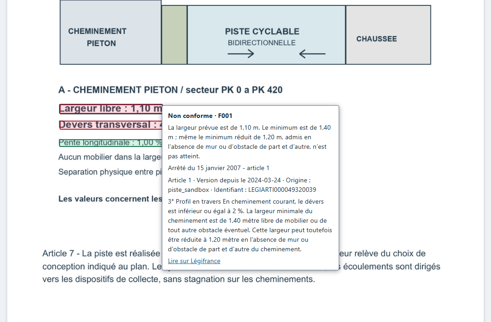

# CCTP Clair

CCTP Clair analyse un cahier des clauses techniques particulières (CCTP) sur Windows ou Mac. Pour chaque critère contrôlé, le rapport montre le passage du contrat, l’article utilisé et la raison du verdict.

## Tester le SLM maintenant

**[Télécharger pour MacBook](https://github.com/HafidIdrissi/cctp-clair/releases/latest/download/CCTP-Clair-Mac.zip)** · **[Télécharger pour Windows](https://github.com/HafidIdrissi/cctp-clair/releases/latest/download/CCTP-Clair-Windows.zip)** · [Ouvrir CCTP Clair s’il est déjà lancé](http://127.0.0.1:8789/)

**Pour tester Rennes**, les trois articles DILA du ZIP suffisent pour démarrer. **Pour votre propre contrat**, vous pouvez enrichir la base locale ou configurer PISTE pour rechercher en ligne un article manquant. [Choisir les textes à installer](#dila-et-api-légifrance-via-piste) · [Configurer PISTE](#configurer-piste-sur-mon-pc)

1. **Sur Mac**, dans le Finder, double-cliquez sur le ZIP. Placez le dossier extrait dans **Documents**, puis double-cliquez sur **Lancer CCTP Clair.command**. **Sur Windows**, faites un clic droit sur le ZIP → **Extraire tout**, puis double-cliquez sur **Lancer CCTP Clair.cmd**.
2. Gardez la fenêtre ouverte. Quand le navigateur s’ouvre, cliquez sur **Tester avec l’exemple**.
3. Dans **Mes rapports**, attendez **Rapport prêt**, puis cliquez sur **Lire le rapport**.

Le bouton analyse **Rennes B avec défauts**, un CCTP fictif de quatre pages, avec les textes DILA inclus au **1er juillet 2024**. Dans **Inspecter le CCTP original**, cherchez la **largeur libre de 1,10 m** et la **pente longitudinale de 1,00 %** sur le plan de la page 2. Survolez les passages encadrés pour lire le motif et ouvrir l’article sur Légifrance.

Le taux affiché dépend des critères tranchés pendant l’analyse. Il correspond au nombre de critères conformes divisé par le nombre de critères ayant reçu un verdict.


Le premier lancement nécessite Internet et plusieurs Go libres. Sur **macOS Sonoma 14 ou ultérieur**, le lanceur prépare Python, Ollama et le modèle local Ministral 3B. Gardez le Terminal ouvert pendant le téléchargement et l’analyse. Les Mac à puce Apple peuvent accélérer le modèle sur le GPU. Sur Mac Intel, le calcul utilise le processeur et peut prendre davantage de temps. Si macOS bloque le lanceur téléchargé depuis cette page, utilisez **Réglages Système → Confidentialité et sécurité → Ouvrir quand même** après la première tentative. [Configuration Mac d’Ollama](https://docs.ollama.com/macos)

Sur **Windows 10 ou 11 (64 bits)** comme sur Mac, le premier exemple fonctionne sans installer n8n ni créer de compte PISTE. Pour tester votre propre contrat, choisissez un fichier, indiquez le lieu et la date, puis cliquez sur **Lancer l’analyse**. Formats acceptés : PDF (15 pages maximum), PNG ou JPEG, jusqu’à 25 Mo.

**Guides animés** · [Voir les annotations](#voir-les-annotations-sur-le-cctp) · [Changer de modèle Ollama](#changer-de-modèle-ollama) · [Utiliser n8n](#tester-depuis-n8n)

## Voir les annotations sur le CCTP

Dans le rapport ou dans **Mes rapports**, cliquez sur **Inspecter le CCTP original**. Survolez un passage encadré, ou sélectionnez-le au clavier. L’annotation affiche le verdict, son motif et le lien **Lire sur Légifrance**.


Sur ce plan de Rennes (page 2), la **largeur libre de 1,10 m** est encadrée en **rouge**. La capture montre le motif, les seuils comparés et l’article utilisé. La **pente de 1,00 %**, encadrée en **vert**, respecte le critère contrôlé.



**Télécharger le CCTP inspecté** enregistre les pages et leurs annotations dans un fichier HTML à rouvrir hors ligne. Les passages dont la position reste incertaine sont listés à la fin.

## Les quatre contrats disponibles

- **Rennes, 4 pages.** Analysez les deux versions au **1er juillet 2024**, avec le même modèle. Page 2, la largeur piétonne passe de **1,10 m** à **1,60 m**. Comparez les justifications dans les rapports. [Version B avec défauts](demo/contrats/CCTP_Rennes_liaison_cyclable_B_avec_defauts_4_pages.pdf) · [Version A corrigée](demo/contrats/CCTP_Rennes_liaison_cyclable_A_version_corrigee_4_pages.pdf) · [Clé de lecture](demo/contrats/Rennes-cle-de-test.md)
- **Nantes, 12 pages.** À la même date, vérifiez les cotes lues dans les plans des pages 7 à 11. [CCTP fictif de Nantes](demo/contrats/CCTP_fictif_Nantes_piste_cyclable_images.pdf)
- **Tain-l’Hermitage, 27 pages.** Ce CCTP original porte sur la maîtrise d’œuvre pour la requalification de trois rues. Pour l’analyser avec la limite actuelle de 15 pages par envoi, ouvrez le PDF puis imprimez les pages 1 à 15 et 16 à 27 dans deux PDF distincts. Chaque envoi produit son propre rapport. [CCTP original de Tain-l’Hermitage](demo/contrats/CCTP_Tain_LHermitage_2024_original.pdf)

## Changer de modèle Ollama


Dans **Votre document → Choisir le modèle local → Comparaison juridique**, sélectionnez un modèle puis lancez l’essai. Pour en ajouter un sur Windows, ouvrez **PowerShell** et tapez par exemple `ollama pull qwen3:4b`. Sur Mac, gardez CCTP Clair ouvert et tapez dans une nouvelle fenêtre de **Terminal** `curl -f http://127.0.0.1:11434/api/pull -d '{"model":"qwen3:4b"}'`. Quand le téléchargement se termine, actualisez la page. La lecture des images utilise Ministral 3B.

## Tester depuis n8n

**Où saisir mes clés PISTE ?** Dans le workflow **CCTP Clair - Relais PISTE sandbox**, ouvrez le troisième nœud **PISTE · recherche ou article**. Les champs **Client ID** et **Client Secret** se trouvent dans son identifiant **OAuth2 API**. [Suivre les étapes dans n8n](#saisir-les-clés-piste-dans-n8n)


**Voir le workflow complet.** Sur le PC de développement, [ouvrir le workflow SLM CCTP Clair dans n8n](http://localhost:5678/workflow/SlmCctpClairV1). Dans l’éditeur, utilisez **Zoom to fit** pour afficher les deux entrées (interface et formulaire), le contrôle du moteur, le suivi de l’analyse et la remise du rapport. L’OCR, la recherche DILA/PISTE et la comparaison juridique s’exécutent dans le moteur Python appelé par le workflow.

Sur un autre PC, ouvrez un workflow vide et choisissez **⋯ → Import from File** puis [SLM CCTP Clair complet.json](n8n/SLM%20CCTP%20Clair%20complet.json) pour explorer les 16 nœuds et leur note. Son exécution nécessite le moteur de développement attendu sur le port `8776`. L’entrée par l’interface utilise aussi l’interface sur `8777` et un identifiant **Header Auth** à configurer dans n8n.

**Lancer la démo du ZIP.** Ce parcours utilise deux nœuds et le service portable sur le port `8789`.

[Voir le GIF du test rapide à deux nœuds](guide/tester-n8n.gif)

1. Lancez CCTP Clair et [ouvrez n8n](http://localhost:5678/) sur le même ordinateur. Ce workflow utilise une installation locale de n8n.
2. Dans un workflow vide, cliquez sur **⋯ → Import from File** et sélectionnez [Tester CCTP Clair.json](n8n/Tester%20CCTP%20Clair.json) dans le dossier **n8n** du ZIP extrait.
3. Cliquez sur **Execute workflow**. Dans **Analyser le PDF fictif → Output**, ouvrez le lien `url` pour suivre l’analyse et lire le rapport.

## DILA et API Légifrance via PISTE

| Votre besoin | Textes disponibles sur votre ordinateur |
| --- | --- |
| **Tester Rennes B** | Le ZIP contient trois articles de voirie et d’accessibilité, chargés au premier lancement. Vous pouvez ainsi essayer l’outil sans télécharger plusieurs Go d’archives juridiques. [Voir les trois XML](demo/legi) |
| **Analyser un autre CCTP de voirie** | Le lanceur **Actualiser les textes DILA** télécharge les archives LEGI et leurs mises à jour. Il indexe une sélection couvrant notamment la voirie, les transports, la commande publique et l’accessibilité. |
| **Rechercher aussi dans d’autres domaines** | Le mode avancé **LEGI complet** importe les articles du fonds LEGI sans filtre par titre. Il s’utilise en ligne de commande. |

**Pour installer la sélection voirie**, lancez CCTP Clair une première fois et attendez la fin des analyses en cours. Dans le dossier extrait, double-cliquez sur **Actualiser les textes DILA.command** (Mac) ou **Actualiser les textes DILA.cmd** (Windows), confirmez avec **O** et attendez le message de fin. Prévoyez Internet et plusieurs Go libres. Aucun compte PISTE n’est nécessaire. [Archives officielles DILA](https://echanges.dila.gouv.fr/OPENDATA/LEGI/)


<details>
<summary><strong>Importer le fonds LEGI complet sur Windows ou Mac</strong></summary>

Sur une installation neuve, lancez CCTP Clair une première fois, puis ouvrez un terminal dans le dossier qui contient le lanceur. Choisissez cette commande dès le départ si vous souhaitez un index complet. L’import demande davantage d’espace et de temps que la sélection voirie.

**Windows — PowerShell**

```powershell
.\.venv\Scripts\python.exe -B tools\sync_dila_local.py --scope all --with-deltas
```

**Mac — Terminal**

```bash
SSL_CERT_FILE=/etc/ssl/cert.pem ./local/macos/python-3.11.18/python/bin/python3.11 -B tools/sync_dila_local.py --scope all --with-deltas
```

Pour les prochaines mises à jour de cet index, réutilisez la commande complète. Le lanceur par double-clic utilise la sélection voirie. L’import complet sur une installation neuve reste à valider de bout en bout.

</details>

**Comment lire le résultat sur un autre contrat ?** Si le rapport affiche **0 conforme et 0 non conforme**, aucun critère n’a reçu de verdict. Même avec davantage de textes disponibles, il faut un passage exploitable et une règle applicable à la date choisie pour conclure. PISTE peut compléter la recherche lorsqu’un article manque dans la base locale.

### Configurer PISTE sur mon PC

**Sur le portail PISTE**

1. Créez un compte, activez-le puis connectez-vous. PISTE crée automatiquement votre application de test, appelée **sandbox**. [Créer mon compte PISTE](https://piste.gouv.fr/registration)
2. Dans **API → Consentement CGU API**, recherchez **Légifrance** et validez les conditions demandées pour cette API. Dans **Applications**, ouvrez votre application **sandbox**, cliquez sur **Modifier l’application**, cochez **Légifrance** dans la liste des API et enregistrez. [Aide officielle Légifrance](https://www.legifrance.gouv.fr/contenu/pied-de-page/foire-aux-questions-api)
3. Dans cette application, ouvrez **API souscrites → Identifiants OAuth**. Gardez cet écran ouvert pour retrouver le **Client ID** et le **Client Secret**. Saisissez-les uniquement dans votre n8n local.

### Saisir les clés PISTE dans n8n

1. **Ouvrez le relais.** Après le premier lancement de CCTP Clair, démarrez n8n sur le même ordinateur. Dans le dossier extrait, double-cliquez sur **Configurer PISTE.command** (Mac) ou **Configurer PISTE.cmd** (Windows). Laissez sa fenêtre ouverte. Dans votre n8n local, créez un workflow vide, cliquez sur **⋯ → Import from File** et choisissez **n8n/Relais PISTE sandbox.json**. Quatre nœuds apparaissent. [Ouvrir mon n8n local](http://localhost:5678/) · [Installer n8n](https://docs.n8n.io/hosting/installation/npm/) · [Fichier du relais](n8n/Relais%20PISTE%20sandbox.json)
2. **Reliez CCTP Clair à n8n.** Double-cliquez sur le **premier nœud à gauche, « Rechercher un critère manquant »**. Dans **Parameters**, sous **Authentication → Header Auth**, ouvrez la liste des identifiants et choisissez **Create new credential**. Dans **Name** et **Value**, recopiez les deux valeurs affichées par la fenêtre **Configurer PISTE** sur votre ordinateur. Cliquez sur **Save**, puis revenez au workflow.
3. **Saisissez vos clés du portail PISTE.** Double-cliquez sur le **troisième nœud en partant de la gauche, « PISTE · recherche ou article »**. Dans **Parameters**, vous trouverez **Authentication → Generic Credential Type**, puis **Generic Auth Type → OAuth2 API**. Juste en dessous, ouvrez la liste des identifiants et cliquez sur **Create new credential**. Dans l’onglet **Connection**, remplissez ces champs. [Aide n8n sur la création d’un identifiant](https://docs.n8n.io/credentials/add-edit-credentials/)

   | Champ dans n8n | Valeur à saisir |
   | --- | --- |
   | **Grant Type** | Choisissez **Client Credentials**. |
   | **Access Token URL** | `https://sandbox-oauth.piste.gouv.fr/api/oauth/token` |
   | **Client ID** | Collez le **Client ID** de votre application **sandbox** sur le portail PISTE. |
   | **Client Secret** | Collez le **Client Secret** de cette même application dans le champ masqué. |
   | **Scope** | `openid` |
   | **Authentication** | Choisissez **Body**. |

4. **Enregistrez et vérifiez.** Cliquez sur **Save**, vérifiez que l’identifiant enregistré est sélectionné dans le troisième nœud, puis revenez au workflow et cliquez sur **Publish** (ou activez **Active**, selon votre version de n8n). Revenez dans la fenêtre **Configurer PISTE** et appuyez sur **Entrée**. Le message **« Article reçu. PISTE est actif pour les prochaines analyses. »** confirme un appel réussi avec votre compte. Gardez n8n ouvert pendant les analyses qui utilisent PISTE.

Si le test échoue, vérifiez que n8n est ouvert, que le workflow est publié et que vos identifiants proviennent de l’application **sandbox** abonnée à Légifrance. Les appels utilisent le quota de cette application. [Dépanner un accès PISTE](https://www.legifrance.gouv.fr/contenu/pied-de-page/foire-aux-questions-api)


Pour revenir au mode local, rouvrez le même lanceur **Configurer PISTE** et confirmez avec **O**.

## Partie technique — comment fonctionne le SLM ?

Le service Python lit le texte du PDF et utilise la reconnaissance de caractères (OCR) et le modèle visuel pour lire les plans. Il recherche dans son index local SQLite les articles DILA applicables à la date choisie. Le modèle Ollama rapproche chaque prescription de la règle trouvée. Python vérifie les seuils chiffrés pris en charge et produit le rapport annoté. Une preuve illisible ou une règle manquante peut laisser un passage sans décision. [Code du moteur](tools/slm_core_engine.py)

Les documents et les rapports sont conservés sur votre PC dans `local/`. [Sources juridiques](demo/SOURCES.md) · [Guide détaillé de la version 1.1.2](https://github.com/HafidIdrissi/cctp-clair/blob/v1.1.2/README.md)
