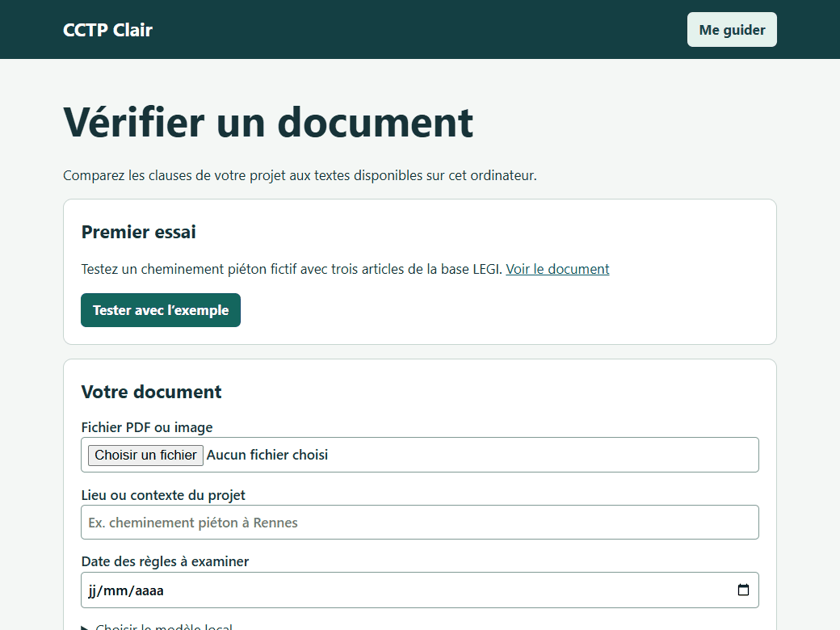
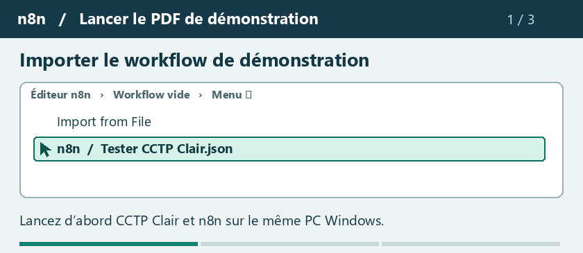
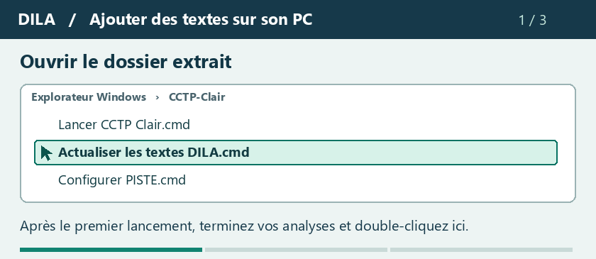

# CCTP Clair

CCTP Clair analyse un cahier des clauses techniques particulières (CCTP) sur votre PC. Pour chaque critère contrôlé, le rapport montre le passage du contrat, l’article utilisé et la raison du verdict.

## Tester le SLM maintenant

**[Télécharger pour Windows](https://github.com/HafidIdrissi/cctp-clair/releases/latest/download/CCTP-Clair-Windows.zip)** · [Ouvrir CCTP Clair s’il est déjà lancé](http://127.0.0.1:8789/)

1. Faites un clic droit sur le ZIP → **Extraire tout**. Dans le dossier extrait, double-cliquez sur **Lancer CCTP Clair.cmd**.
2. Gardez la fenêtre ouverte. Quand le navigateur s’ouvre, cliquez sur **Tester avec l’exemple**.
3. Dans **Mes rapports**, attendez **Rapport prêt**, puis cliquez sur **Lire le rapport**.

Le premier lancement nécessite Windows 10 ou 11 (64 bits), Internet et plusieurs Go libres. Pour tester votre propre contrat, choisissez un fichier, indiquez le lieu et la date, puis cliquez sur **Lancer l’analyse**. Formats acceptés : PDF (15 pages maximum), PNG ou JPEG, jusqu’à 25 Mo.

**Guides animés** · [Changer de modèle Ollama](#changer-de-modèle-ollama) · [Utiliser n8n](#tester-depuis-n8n)

## Refaire les essais avec les contrats fictifs

- **Rennes, 4 pages.** Analysez les deux versions au **1er juillet 2024**, avec le même modèle. Page 2, la largeur piétonne passe de **1,10 m** à **1,60 m**. Comparez les justifications dans les rapports. [Version B avec défauts](demo/contrats/CCTP_Rennes_liaison_cyclable_B_avec_defauts_4_pages.pdf) · [Version A corrigée](demo/contrats/CCTP_Rennes_liaison_cyclable_A_version_corrigee_4_pages.pdf) · [Clé de lecture](demo/contrats/Rennes-cle-de-test.md)
- **Nantes, 12 pages.** À la même date, vérifiez les cotes lues dans les plans des pages 7 à 11. [PDF de Nantes](demo/contrats/CCTP_fictif_Nantes_piste_cyclable_images.pdf) · [Tous les contrats fictifs](demo/contrats)

## Changer de modèle Ollama

Dans **Votre document → Choisir le modèle local → Comparaison juridique**, sélectionnez un modèle puis lancez l’essai. Pour en ajouter un, ouvrez **PowerShell**, tapez par exemple `ollama pull qwen3:4b`, puis actualisez la page avec **F5**. La lecture des images utilise Ministral 3B.

## Tester depuis n8n

1. Lancez CCTP Clair et [ouvrez n8n](http://localhost:5678/) sur le même PC Windows. Ce workflow utilise une installation locale de n8n.
2. Dans un workflow vide, cliquez sur **⋯ → Import from File** et sélectionnez [Tester CCTP Clair.json](n8n/Tester%20CCTP%20Clair.json) dans le dossier **n8n** du ZIP extrait.
3. Cliquez sur **Execute workflow**. Dans **Analyser le PDF fictif → Output**, ouvrez le lien `url` pour suivre l’analyse et lire le rapport.

## DILA et API Légifrance via PISTE

**DILA fonctionne dès le premier essai.** Les trois articles XML fournis sont indexés sur votre PC au démarrage, sans compte. Pour ajouter les textes de mobilité, terminez les analyses en cours, double-cliquez sur **Actualiser les textes DILA.cmd**, puis appuyez sur **O** pour confirmer. Attendez le message **Index local mis a jour** avant de lancer un nouveau contrôle. Prévoyez Internet et plusieurs Go libres. [Voir les XML inclus](demo/legi) · [Archives officielles DILA](https://echanges.dila.gouv.fr/OPENDATA/LEGI/)

**PISTE est facultatif.** Activez-le si vous souhaitez que le moteur recherche aussi des articles en ligne lorsque les sources locales sont insuffisantes. Le relais fourni utilise l’environnement de test (*sandbox*) et les quotas de votre application.

<strong>Activer PISTE sur mon PC Windows</strong>

1. Lancez CCTP Clair une première fois. Démarrez aussi n8n directement sur le même PC, sur le port 5678. [Installation locale de n8n](https://docs.n8n.io/hosting/installation/npm/)
2. Créez votre compte PISTE. Dans votre espace, ouvrez votre application **sandbox**, accordez-lui l’accès à l’API **Légifrance** et acceptez les conditions demandées. Gardez son **Client ID** et son **Client Secret** pour l’étape 4. [Inscription PISTE](https://piste.gouv.fr/registration) · [Fiche officielle de l’API](https://www.data.gouv.fr/dataservices/legifrance)
3. Dans le dossier extrait, double-cliquez sur **Configurer PISTE.cmd** et gardez la fenêtre ouverte. Dans n8n, créez un workflow vide, puis choisissez **⋯ → Import from File** et ouvrez [Relais PISTE sandbox.json](n8n/Relais%20PISTE%20sandbox.json). Dans le premier nœud **Rechercher un critère manquant**, créez un identifiant **Header Auth** et copiez les champs **Name** et **Value** affichés par l’assistant. Cette clé relie CCTP Clair à votre n8n.
4. Dans le nœud **PISTE · recherche ou article**, créez un identifiant **OAuth2 API**. Choisissez **Client Credentials**, saisissez vos deux identifiants PISTE, puis renseignez les champs suivants.

   | Champ dans n8n | Valeur |
   | --- | --- |
   | Access Token URL | `https://sandbox-oauth.piste.gouv.fr/api/oauth/token` |
   | Scope | `openid` |
   | Authentication | `Body` |

5. Enregistrez les identifiants et **publiez ou activez le workflow**. Revenez à la fenêtre **Configurer PISTE** et appuyez sur **Entrée**. Le message **Article reçu** confirme qu’un article a été récupéré avec votre compte et active PISTE pour les prochaines analyses. Pour revenir au mode local, rouvrez le même assistant et confirmez avec **O**.

## Partie technique — comment fonctionne le SLM ?

Le service Python lit le texte du PDF et utilise la reconnaissance de caractères (OCR) et le modèle visuel pour lire les plans. Il recherche dans son index local SQLite les articles DILA applicables à la date choisie. Le modèle Ollama rapproche chaque prescription de la règle trouvée. Python vérifie les seuils chiffrés pris en charge et produit le rapport annoté. Une preuve illisible ou une règle manquante peut laisser un passage sans décision. [Code du moteur](tools/slm_core_engine.py)

Les documents et les rapports sont conservés sur votre PC dans `local/`. [Sources juridiques](demo/SOURCES.md) · [Guide détaillé de la version 1.1.2](https://github.com/HafidIdrissi/cctp-clair/blob/v1.1.2/README.md)
